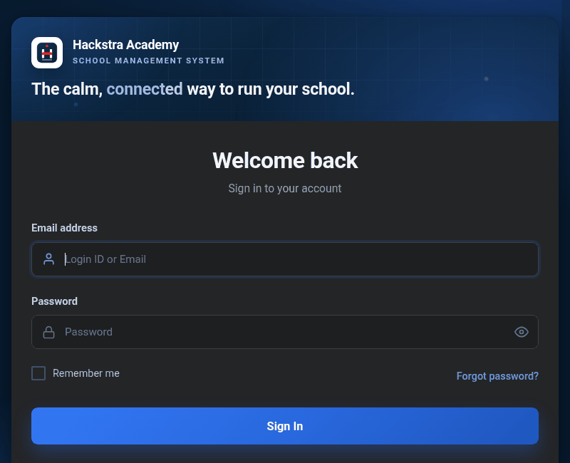

# ANKIT KUMAR

### Thunderdoc · B.Tech CSE (AI/ML) · Madurai, India

> "I believe in learning by building, solving real-world problems with technology, and turning every challenge into an opportunity to grow."

💼 [LinkedIn](https://linkedin.com/in/ankitkrsingh07) · 🐦 [X](https://x.com/RajAnkit2163) · 📸 [Instagram](https://instagram.com/kr_ankit_05) · ✉️ [ankitraj2163@gmail.com](mailto:ankitraj2163@gmail.com)

---

## 📍 Now — October 2026

- 🧺 Refining **LaundryAI**'s fabric-care CNN for real-world photos
- 🏫 Building **Hackstra**, my school-management platform
- 📩 Hunting a **paid internship** — AI/ML, Python, or full-stack · remote or Bangalore / Chennai / Hyderabad

---

## 🚀 Builds — problem → build → learned

**📚 NPTEL Exam Practice Hub**
*Problem:* NPTEL Geography & Environment ke liye mobile-first practice chahiye thi — aur NPTEL koi public answer key nahi deta.
*Build:* 130 portal-verified MCQs (Weeks 0–12), submit-all week tests, timed mocks, study questions, smart revision — Google/email sign-in, Firebase-synced progress.
*Learned:* Verification beats claims — har answer portal se match karke hi ship kiya.
🔗 [Live app](https://nptel-exam-practice-hub.vercel.app) · [Repo](https://github.com/Thunderdoc/nptel-exam-practice-hub)

**🏫 Hackstra — School Management Platform**
*Problem:* Schools ko ek complete system chahiye tha — admissions se lekar fees tak, ek jagah.
*Build:* Laravel 12 par poora platform — period attendance, exams & marks, fees with online payment, library, timetables, staffing, documents.
*Learned:* Real users ke liye banana — live demo par test karke hi claim karna.
🔗 [Live demo](https://hackastra.onrender.com)

**🧺 LaundryAI — AI Fabric Care**
*Problem:* Photo dekhkar kapde ka fabric pehchanna aur sahi care batana mushkil tha.
*Build:* CNN pipeline par photo-based fabric classification with care recommendations.
*Learned:* Lab accuracy aur real-world accuracy alag hoti hai — asli photos par test karna hi asli test hai.
🔗 [Repo](https://github.com/Thunderdoc/AI-Laundry-Assistant)

📂 More builds

 

**✈️ AeroPrice** — AI-powered real-time airfare price intelligence and CPI augmentation for India (Smart India Hackathon team project). TypeScript · React · Supabase — [Repo](https://github.com/Thunderdoc/Aero-Price-Production)

**🌡️ ThermalTrace AI** — Geospatial AI classifying NASA FIRMS thermal hotspots (Industrial / Mining / Agricultural / Unclassified) — XGBoost, PostGIS, OpenStreetMap. **Team project with my friend Ved.** — [Repo](https://github.com/VedK5643/Thermal-Trace)

**🧭 Career Guidance AI** — Career guidance app with Streamlit and LLMs. — [Repo](https://github.com/Thunderdoc/career_guidance_llm_app)

**📖 EduFlow** — AI-powered autonomous learning platform (React + TypeScript, web + Android, offline-first): adaptive Learn → Test → Analyze → Adapt loop. — [Repo](https://github.com/Thunderdoc/EduTwin)

**📊 Dynamic Pricing** — Capstone: dynamic pricing for urban parking lots (Summer Analytics 2025). — [Repo](https://github.com/Thunderdoc/Dynamic-Pricing-SummerAnalytics2025)

**🚪 Smart Gate AI — Coming Soon** — Face-recognition gate security with visitor appointments, for offices, colleges, facilities. Not launched yet — more here when it ships.

---

## ⚡ Arsenal

**✅ Proven in shipped work:** Python · PyTorch · TypeScript · React · Laravel · Firebase · CNNs
**🌱 Pushing into:** real-world photo robustness · production school data at scale
**Languages:** English · Hindi

---

## 📡 Signal

*Live GitHub data — no hardcoded numbers.*

---

## 🐍 Journey

<picture>
  <source media="(prefers-color-scheme: dark)" srcset="https://raw.githubusercontent.com/Thunderdoc/Thunderdoc/output/github-contribution-grid-snake-dark.svg"/>
  <source media="(prefers-color-scheme: light)" srcset="https://raw.githubusercontent.com/Thunderdoc/Thunderdoc/output/github-contribution-grid-snake.svg"/>
  
</picture>

---

Turning complex ideas into impactful digital experiences. ◆ Built by Thunderdoc

