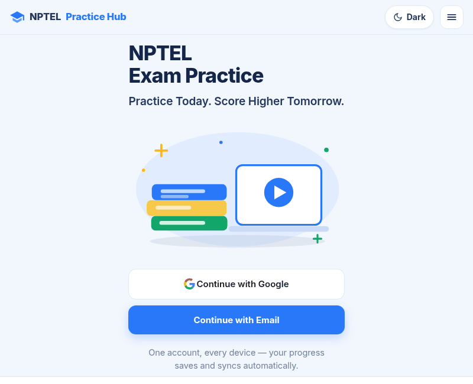
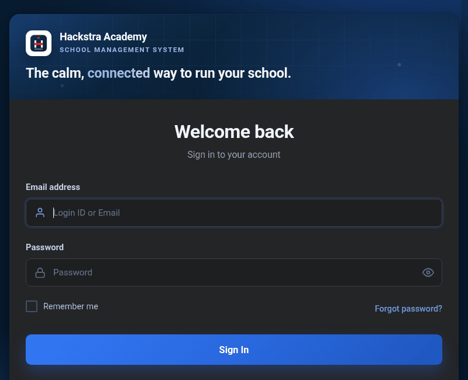

# THUNDERDOC

### Thunderdoc · B.Tech CSE (AI/ML) · Madurai, India

> "I believe in learning by building, solving real-world problems with technology, and turning every challenge into an opportunity to grow."

---

## 📍 Now — October 2026

- 🧺 Refining **LaundryAI**'s fabric-care CNN for real-world photos
- 🏫 Building **Hackstra**, my school-management platform
- 📩 Hunting a **paid internship** — AI/ML, Python, or full-stack · remote or Bangalore / Chennai / Hyderabad

---

## 🚀 Builds — problem → build → learned

**📚 NPTEL Exam Practice Hub**

*Problem:* NPTEL Geography & Environment had no mobile-first practice, and NPTEL publishes no public API or question bank.
*Build:* 130 portal-verified MCQs (Weeks 0–12), submit-all week tests, timed mocks, study questions and a final exam.
*Learned:* Verification beats claims — every answer was matched against the portal before shipping.

**🏫 Hackstra — School Management Platform**

*Problem:* Schools needed one complete system — from admissions to fees — in one place.
*Build:* A full platform on Laravel 12 — period attendance, exams & marks, fees with online payment, role-based dashboards and a live demo.
*Learned:* Build for real users — claim it only after testing it on the live demo.

---

## 📊 GitHub Stats

---

## 🐍 Contribution Snake

---

